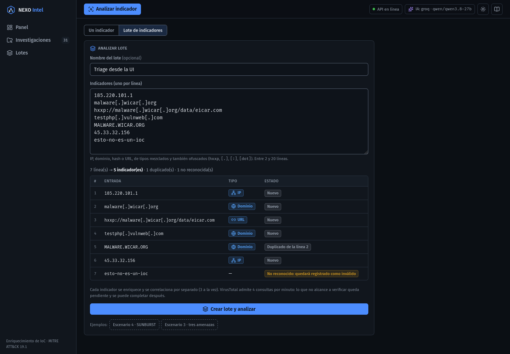
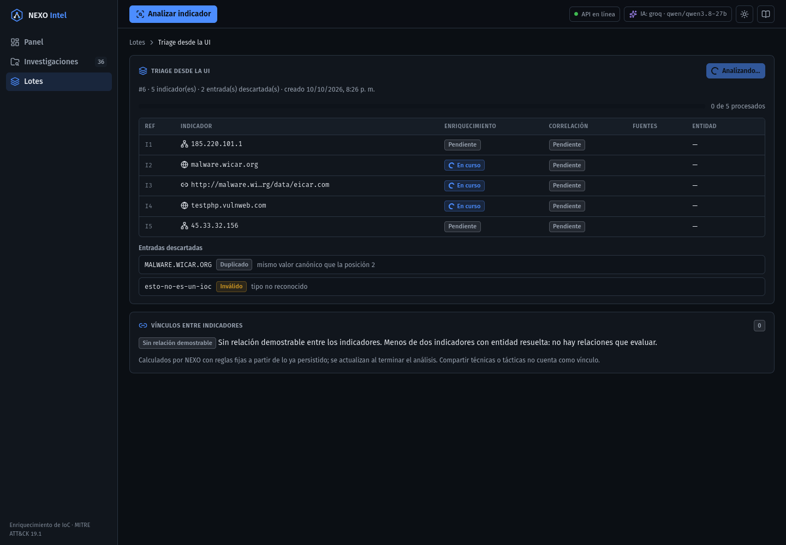
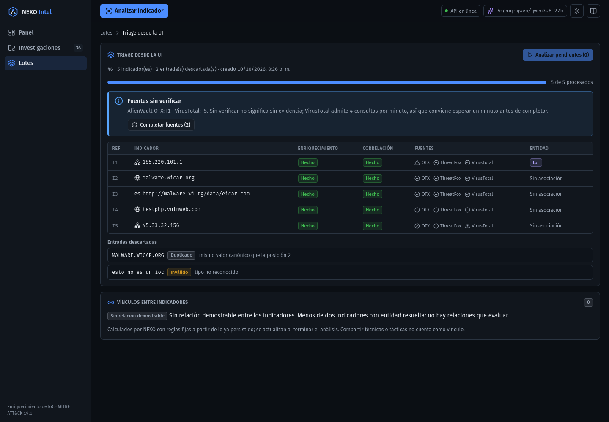
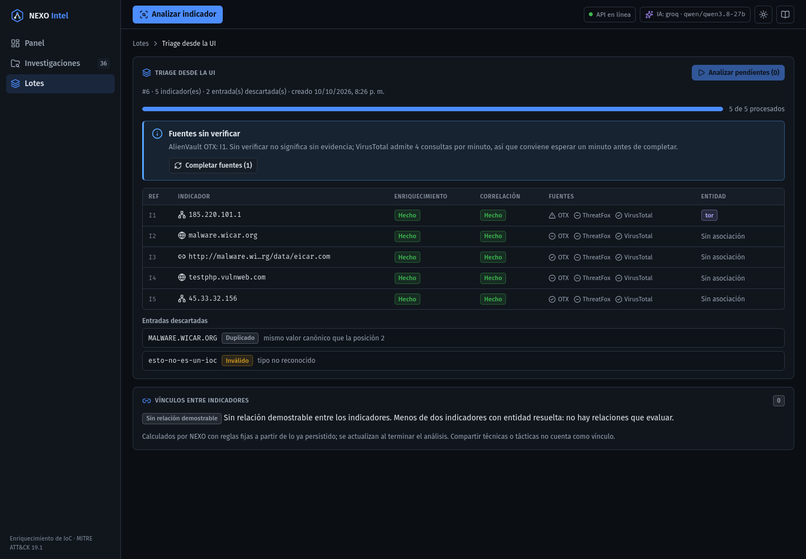
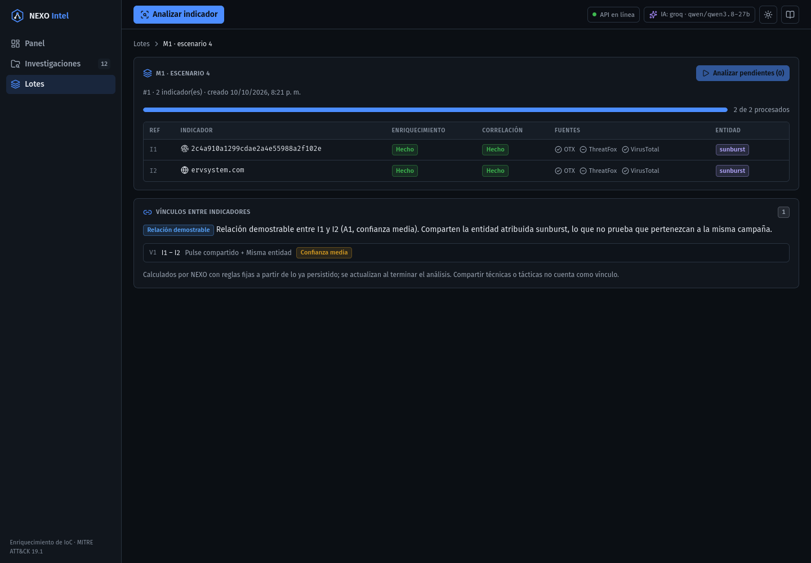
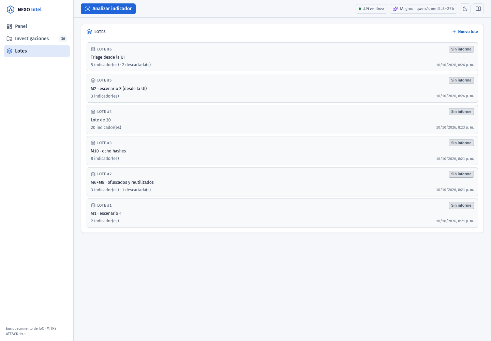
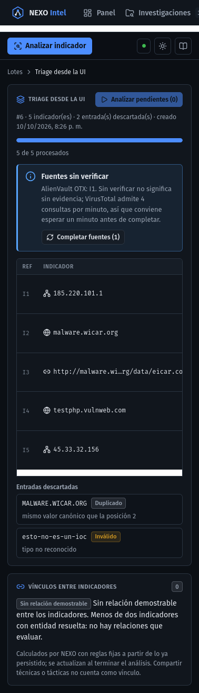

# Fase 7d — Lotes en la interfaz: ingreso en bloque, lista y progreso

Fecha: 2026-10-10. Primera fase de frontend del plan de la Fase 7 (backend
`docs/evolucion/fase-07-campanas-plan.md`, §2.11). Consume `POST /batches`, `GET /batches` y
`GET /batches/{id}` (backend 7a–7c).

**Objetivo:** que el analista pegue un bloque de IoCs, cree el lote y vea cómo NEXO enriquece
y correlaciona cada indicador, con el estado de cada fuente y los vínculos que calcula el
backend. El informe conjunto y su validación llegan en la 7e.

## Qué se hizo

| Pieza | Archivo | Qué hace |
|---|---|---|
| Contrato | `api/types.ts`, `api/nexo.ts` | Tipos de lote, ítem, correlación del lote, informe y validación; `createBatch`, `listBatches`, `getBatch` |
| Dominio | `domain/batch.ts` | `parseBlock` (un indicador por línea, con `detectType`; marca los duplicados por su valor sin ofuscar), `ordenDeProceso` (hashes primero), `estadoPaso`, `miembroListo`, `fuentesFallidas` y etiquetas |
| Acciones | `state/pipelineActions.ts` | `createBatch`, `loadBatch`, `listBatches`, `analyzeBatch` y `completeSources`; `runAutomatic(inv, pasos, forzar)` |
| Reducer | `state/investigations.ts` | `loaded` acepta la `entrada` original: un miembro del lote conserva lo que pegó el analista (p. ej. `8[.]8[.]8[.]8`) |
| Rutas | `hooks/useRoute.ts` | `#/analizar/lote`, `#/lotes` y `#/lotes/:id` |
| Pantallas | `components/batch/` | `BatchForm` (ingreso con vista previa), `BatchPage` (progreso, fuentes sin verificar, descartes y vínculos) y `BatchList` |
| Navegación | `App.tsx`, `layout/SideNav.tsx` | Selector "Un indicador / Lote de indicadores" en Analizar y la entrada "Lotes" en el menú |

### Orquestación (opción a del plan)

**Cómo se procesa cada miembro:**

- **Ingesta en el backend:** `POST /batches` registra el lote en una transacción.
  `createBatch` trae enseguida los miembros (`GET /batches/{id}`) y los fusiona en la caché.
- **Pasos en el frontend:** el frontend orquesta `enrich → correlate` por miembro, con los
  mismos candados que el análisis individual, **3 a la vez** (`CONCURRENCIA_LOTE`).
- **Orden:** primero los hashes, porque es donde más aporta el cupo de 4 consultas/min de
  VirusTotal.
- **Sin informe individual:** el informe conjunto (7e) hace una sola llamada al LLM para todo
  el lote.
- **Fallos aislados:** un fallo no detiene al resto. Queda en la actividad del indicador, con
  "Reintentar" en su fila.

**Botones de la página del lote:**

- **"Analizar pendientes"** procesa solo lo que falta. Si se cerró la pestaña, se reanuda al
  volver.
- **"Completar fuentes"** repite `enrich → correlate` (forzado) solo en los miembros con alguna
  fuente sin verificar. `/enrich` reconsulta únicamente las fuentes sin caché, y la correlación
  se recalcula con la evidencia nueva.

**Sin caché local:** el lote no se guarda en `localStorage`. Se pide al abrirlo y se vuelve a
pedir cuando termina cada tanda, porque la correlación entre indicadores la calcula el backend
sobre lo persistido.

## Resultados contra el backend real

Las acciones del frontend (`createBatch` → `analyzeBatch` → `loadBatch` → `completeSources`)
se ejecutaron contra el backend con OTX, ThreatFox y VirusTotal reales, sobre una base local
desechable (no Supabase):

| Caso | Resultado |
|---|---|
| **M1** (escenario 4) | 2 miembros analizados en 14,2 s. Relación demostrable `A1` (I1–I2), confianza media, por pulse compartido y misma entidad (sunburst) |
| **M6** (ofuscados y mayúsculas: `HXXPS://ERVSYSTEM[.]COM/`, `ervsystem[dot]com`, `ervsystem.com`, el hash en mayúsculas) | URL nueva normalizada a `https://ervsystem.com/`, dominio y hash `existente` y un `duplicado`. La URL quedó sin entidad (OTX no la conoce), así que no participa: abstención y no un vínculo forzado |
| **M8** (reutilizados) | Solo se analizó lo nuevo, en 0,9 s; los miembros ya procesados no se vuelven a enviar a las fuentes |
| **M10** (8 hashes) | Para cuando corrió M10, M1 y M6 ya habían gastado 3 de las 4 consultas por minuto de VirusTotal, así que en ese minuto solo se verificó un hash. 61 s después, "Completar fuentes" verificó 4 más. Quedaron 3 sin verificar, declarados como cobertura `parcial` (`VirusTotal: 5 verificados, sin verificar I6, I7, I8`) |
| **Lote de 20** (dominios, IPs y URLs) | **6,8 s** desde `POST /batches` hasta la última correlación. `/enrich` tardó entre 366 ms y 2,1 s, con una mediana de 675 ms. VirusTotal no participó (cupo agotado en ese minuto) y el lote lo declara como cobertura parcial. 7 de 20 resolvieron entidad; no hubo vínculos |

### Flujo completo por la interfaz

Se recorrió en Firefox headless, automatizado con WebDriver BiDi. La extensión de Chrome no
estaba conectada.

1. **Vista previa.** Pegar un bloque de 7 líneas mezcladas y ofuscadas da 5 indicadores
   (IP, dominio, URL), 1 duplicado (`MALWARE.WICAR.ORG` es el mismo valor que la línea 2) y 1
   línea no reconocida.
2. **En curso.** Al crear el lote, la página muestra 3 indicadores "En curso" a la vez y el
   resto "Pendiente".
3. **Procesado.** Quedan 5 de 5 procesados, con las entradas descartadas a la vista y el aviso
   "Fuentes sin verificar": OTX falló en I1 y VirusTotal no tenía cupo para I5.
4. **Completar fuentes.** Un minuto después, VirusTotal verificó I5. OTX siguió fallando en I1,
   y el aviso lo sigue declarando.

| Analizar lote (vista previa) | En curso (3 a la vez) |
|---|---|
|  |  |
| **Procesado, con fuentes sin verificar** | **Después de completar fuentes** |
|  |  |
| **M1: relación demostrable** | **Lotes (tema claro)** |
|  |  |

Móvil (390 px): . La tabla de miembros se
desplaza en horizontal dentro de su recuadro, y la página no.

## Verificación

- `npm run lint`, `typecheck`, `coverage` y `build` en verde.
- **171 pruebas**, frente a 140 antes. Cobertura total: 97,6 % de sentencias, 92,7 % de ramas,
  97,8 % de funciones y 98,8 % de líneas.
- **`domain/batch.test.ts` (7):**
  - Tipos mezclados y ofuscados.
  - Duplicados: no distinguen mayúsculas, salvo en el path de una URL.
  - Líneas no reconocidas.
  - Orden de proceso.
  - Estado de cada paso.
  - Miembro listo.
  - Fuentes sin verificar.
- **`pipelineActions.test.ts` (+7):**
  - Crear un lote fusiona a los miembros con su entrada y analiza **sin** `/report`.
  - Sin `autoRun` no se analiza.
  - Errores al crear y al cargar.
  - La lista de lotes.
  - **Nunca más de 3 en vuelo, con los hashes primero.**
  - Un fallo no detiene al resto.
  - "Completar fuentes" solo toca a los miembros con fuentes fallidas.
- **`investigations.test.ts` (+1):** la entrada del lote no pisa la local.
- **`components/batch/Batch.test.tsx` (11), con la app completa y el backend falso:**
  - Flujo de punta a punta: vista previa → POST → progreso → descartes → completar fuentes.
  - Fallo con "Reintentar", y aviso si la recarga del lote falla.
  - Vínculos.
  - Límites de 2 y 20 líneas.
  - Ejemplos de los escenarios oficiales.
  - Error de creación.
  - Selector de modo.
  - Lista de lotes, vacía y caída.
  - Lote inexistente o caído.
- **`hooks.test.ts` (+5):** las rutas nuevas.

### Criterios de aceptación

| # | Criterio | Estado |
|---|---|---|
| 1 | Lint, typecheck, cobertura de 90 % o más y build | ✅ |
| 2 | `parseBlock` deshace la ofuscación, detecta tipos mezclados, marca duplicados y líneas no reconocidas, y bloquea con más de 20 | ✅ |
| 3 | Nunca más de 3 en vuelo; un 502 no detiene al resto y deja "Reintentar" | ✅ (prueba y captura "En curso") |
| 4 | Al recargar `#/lotes/:id` se reconstruye desde el backend; "Analizar pendientes" procesa solo lo que falta | ✅ (prueba y M8 en vivo) |
| 5 | "Completar fuentes" ejecuta `enrich → correlate` solo en los miembros con fuentes fallidas | ✅ (prueba y en vivo) |
| 6 | Manual con M1, M6, M8 y M10; tiempo de un lote de 20 | ✅ (6,8 s) |

## Diferencias con el plan

- **Un indicador por línea.** No se separa por comas ni espacios: en un bloque pegado de un
  informe, eso convertiría cada palabra en una línea no reconocida y agotaría el tope de 20.
- **Las líneas no reconocidas se envían igual,** con `tipo: null`, para que el lote deje
  constancia de todo lo que se pegó.
- **El modo de análisis va en la URL** (`#/analizar` y `#/analizar/lote`), con dos enlaces en
  lugar de pestañas con estado: así se puede enlazar.
- **El progreso quedó dentro de `BatchPage`,** sin un `BatchProgress` aparte.
  `BatchForm` reutiliza los estilos de `IndicatorForm`, y `BatchList` los de la lista de
  Investigaciones.
- **El panel de vínculos en vivo** estaba en el orden de recorte del plan, pero se incluyó
  porque son unas 20 líneas.
- **El aviso "Fuentes sin verificar" cuenta cualquier fuente fallida** (OTX caída incluida), no
  solo el cupo de VirusTotal: en vivo apareció un error de OTX.

## Observaciones para la 7e

- **Falta el informe conjunto.** "Generar informe conjunto", el detalle del informe (Markdown,
  análisis IA y cobertura ATT&CK) y la validación con historial van en la 7e. La lista de lotes
  ya muestra "Sin informe" y está lista para la conclusión y la decisión.
- **El cupo de VirusTotal es por proceso del backend.** Se nota en sesiones largas: lo que
  consumieron otros análisis en ese minuto también cuenta.
- **El motivo exacto de una fuente fallida se pierde al recargar.** En la sesión, el estado de
  VirusTotal llega como `limite_cuota`, desde la respuesta de `/enrich`. Al recargar desde
  `GET`, aparece como `no_disponible` ("sin respuesta registrada"), porque el backend no guarda
  el motivo. Los dos cuentan como "sin verificar".
- **Barras de desplazamiento claras en móvil.** En Firefox headless se ven claras en el tema
  oscuro, igual que en el resto de la app. No se tocó.
