# Fase 7e — Informe conjunto del lote en la interfaz: resultados, análisis y validación

Fecha: 2026-10-10. Última fase del MVP del plan de la Fase 7 (backend
`docs/evolucion/fase-07-campanas-plan.md`, §2.11). Consume `POST /batches/{id}/report` y
`POST /batch-reports/{id}/validate` (backend 7c).

**Objetivo:** que el analista genere el informe conjunto del lote, vea la conclusión, los
vínculos con su evidencia, la cobertura ATT&CK conjunta y el análisis de IA, y lo acepte o lo
rechace con historial. Con esto, los escenarios 3 y 4 de la propuesta quedan cubiertos de punta
a punta, desde la interfaz.

## Qué se hizo

**Página del lote** (`components/batch/BatchPage.tsx`):

- **Generar informe conjunto:** junto a "Analizar pendientes" hay un botón nuevo, deshabilitado
  si ningún miembro está enriquecido, porque el backend daría 400.
- **Pendientes:** si quedan miembros sin procesar, pide confirmación ("1 indicador(es) sin
  procesar: el informe los declarará como cobertura parcial").
- **Espera y fallo:** muestra la espera con un contador de segundos (el LLM puede tardar hasta un
  minuto) y avisa si la generación falla.

**Resultados del lote** (`components/batch/BatchResults.tsx`): un panel con pestañas.

- **Qué correlación se muestra:** con informe, la que quedó **congelada en esa versión**, que es
  la que se valida; sin informe, la calculada al vuelo, marcada como "Vista previa".
- **Versiones:** el selector de versión gobierna todas las pestañas.

| Pestaña | Contenido |
|---|---|
| Resumen | Banner de conclusión: "Sin relación demostrable entre los indicadores" en tono neutral, con la aclaración de que es un resultado válido, o "Relación demostrable" en tono info. Debajo, las agrupaciones (miembros, confianza, vínculos y técnicas comunes), los que no tienen relación con el resto, los que no participan (estado y severidad) y la cobertura |
| Vínculos | Una tarjeta por par, con todas sus señales: tipo, fuerza (fuerte o contextual), origen y detalle. En el pulse compartido, enlaces a los pulses de OTX; el nombre se muestra como texto. Al pie, la regla de confianza y lo que no se considera señal |
| Cobertura ATT&CK | Aviso "Técnicas documentadas, no comportamiento observado". Técnicas por táctica en orden ATT&CK, con enlace a attack.mitre.org y las referencias de los indicadores. Las que documentan varias entidades llevan borde punteado y su lista en el `title` |
| Análisis IA | La misma vista del informe individual (`AnalisisIAView`), con citas a `E-LOTE`, `E-I#` y `E-V#` que resaltan su bloque del contexto. El modo de selección dice "Técnicas del lote: primero las documentadas para varias entidades…" |
| Informe y validación | El Markdown (`MarkdownReport`, sin HTML crudo), copiar y descargar `.md`, y `DecisionPanel` con "Conclusión propuesta: …" y el historial de esa versión |

**Refactors sin cambio visual**, para reutilizar sin duplicar:

- `AiAnalysisPanel.tsx`: se extrajo `AnalisisIAView({ ia })`.
- `ReportPanel.tsx`: se extrajeron `MarkdownReport` y `MarkdownActions`.
- `ValidationPanel.tsx`: el formulario y el historial pasaron a `DecisionPanel`, con props
  genéricas. `ValidationPanel` conserva sus props y lo envuelve.

Las pruebas existentes de `CaseDetail`, `AiAnalysisPanel` y `App` pasan sin cambiar lo que
afirman.

**Otros cambios:**

- `domain/format.ts::entityTypeLabel`: una entidad `campaña` se muestra como **"Campaña
  ATT&CK"** (en `EvidenceChain` y en la validación), para no confundirla con un lote.
- Acciones `createBatchReport` (timeout de 120 s, como el informe individual) y
  `validateBatchReport`.

## Pruebas manuales contra el backend real

Se corrieron con OTX, ThreatFox, VirusTotal y Groq reales, sobre una base local desechable (no
Supabase). Todo se recorrió **por la interfaz** en Firefox headless, automatizado con WebDriver
BiDi.

| Caso | Resultado |
|---|---|
| **M1** (escenario 4) | **v1:** OTX no respondió para `ervsystem.com`, así que el lote mostró "Fuentes sin verificar: AlienVault OTX: I2" y el informe se **abstuvo** ("Menos de dos indicadores con entidad resuelta"), con cobertura parcial. El análisis lo reconoce como limitación. "Completar fuentes" verificó OTX. **v2:** relación demostrable `A1`, con 4 pulses enfocados compartidos y misma entidad (sunburst), confianza media. Groq tardó 1,3 s y no hubo descartes. El Markdown no tiene **ningún enlace** (`article a` = 0) |
| **M2** (escenario 3) | "Sin relación demostrable entre los indicadores". Cobertura conjunta de 15 tácticas; 28 de 116 técnicas están documentadas para varias entidades (borde punteado) |
| **M3** (escenarios 3 y 4 juntos) | Los 5 indicadores se reutilizaron ("Ya en NEXO"). `A1 = I1–I2` (SUNBURST). "Sin relación demostrable con el resto": I3 (lazarus group), I4 (remcos), I5 (dridex) |
| **M4** (WannaCry y 8.8.8.8) | 8.8.8.8 queda en "No participan": sin entidad atribuible, severidad "Benigno conocido". Abstención |
| **M5** (8.8.8.8 y 1.1.1.1) | No se consultó al modelo. Motivo: "ningún indicador del lote resolvió entidad: por diseño no se consulta al modelo" |
| **M11** (LLM caído, sin respaldo) | El informe (#7) se genera igual. La sección 7 dice "Análisis narrativo no disponible" con el motivo, y la pestaña IA, "El modelo no respondió" con el intento fallido. La conclusión sigue en "Relación demostrable" |
| **M12** (validación) | v1: aceptado y luego rechazado; el historial tiene 2 filas, con "Rechazado" vigente. v2 nació "Pendiente de validación" y se aceptó. Las versiones se eligen en el selector y cada una muestra su decisión |
| **M13** (borrar un miembro) | `DELETE /indicators/{id}` de `ervsystem.com` desvinculó sus ítems de los dos lotes (`batch_items: 2`). En la UI la entrada queda "Eliminado". Las versiones #1, #2 y #7 quedan intactas, y la nueva (#8) se abstiene |

| M1 v1: fuente sin verificar y abstención | M1 v2: resumen con relación |
|---|---|
| 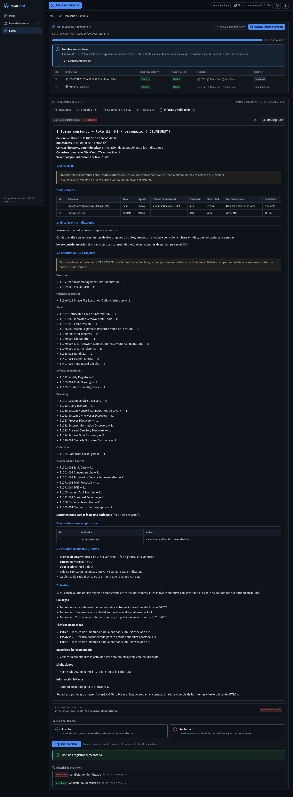 | 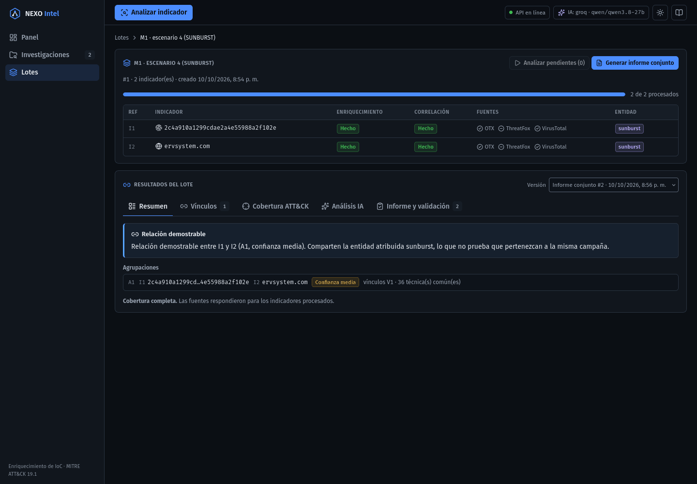 |
| **Vínculos (señales con su fuente)** | **Cobertura ATT&CK** |
| 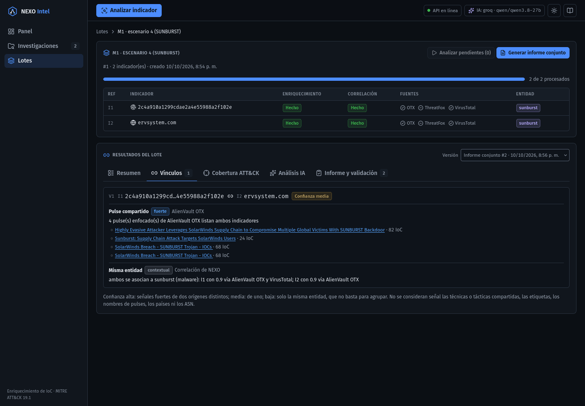 | 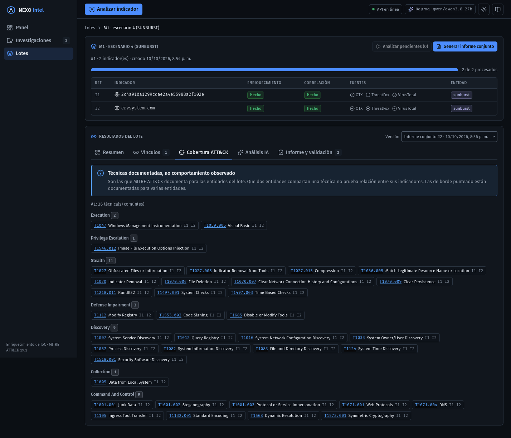 |
| **Análisis IA con citas del lote** | **Informe y validación** |
| 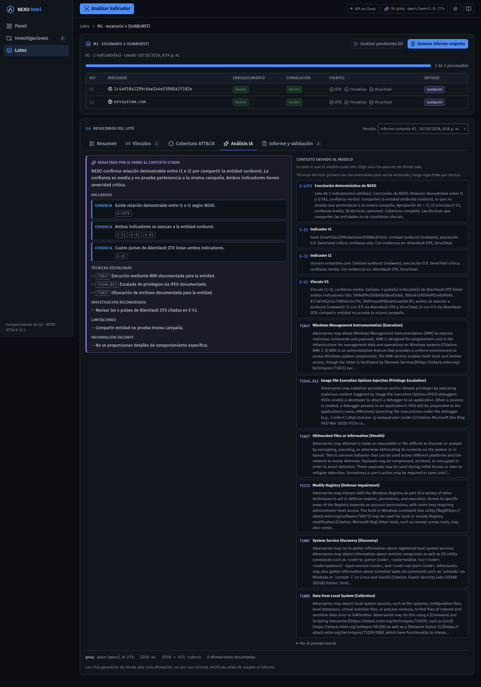 | 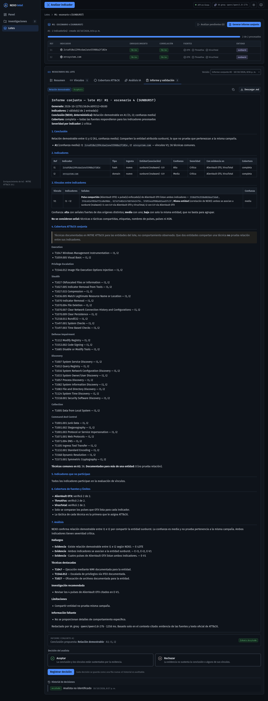 |
| **M2: técnicas de varias entidades (claro)** | **M3: agrupación y aislados** |
| 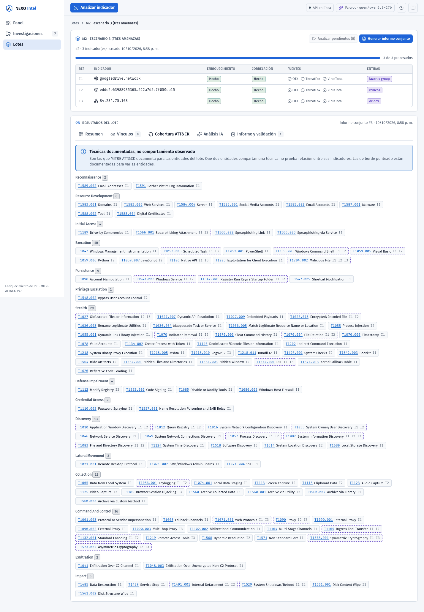 | 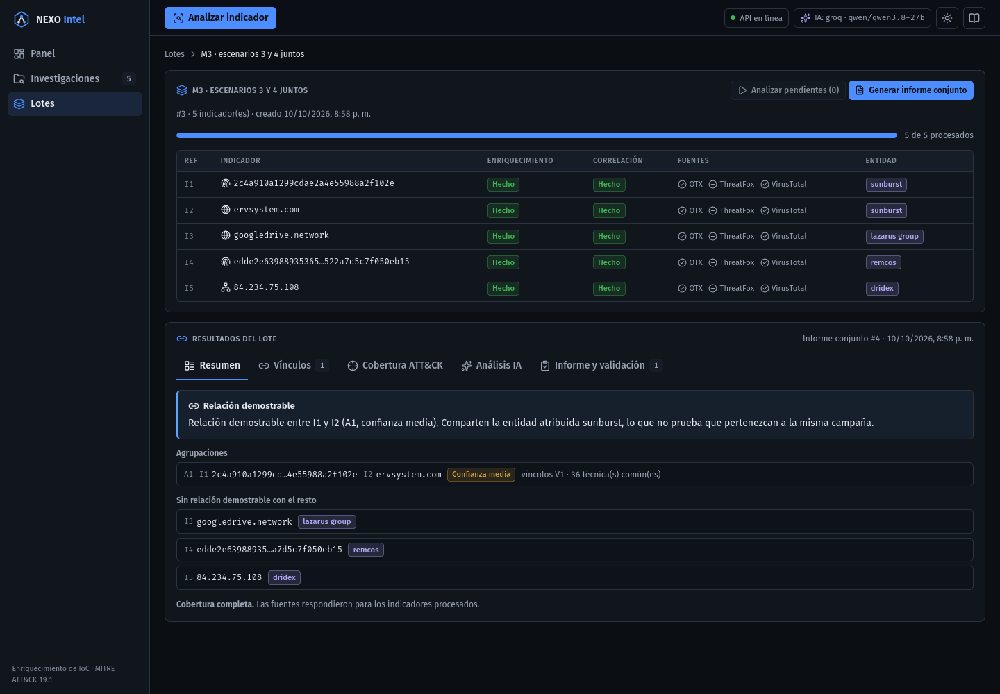 |
| **M4: el benigno no participa** | **M5: no se consulta al modelo** |
| 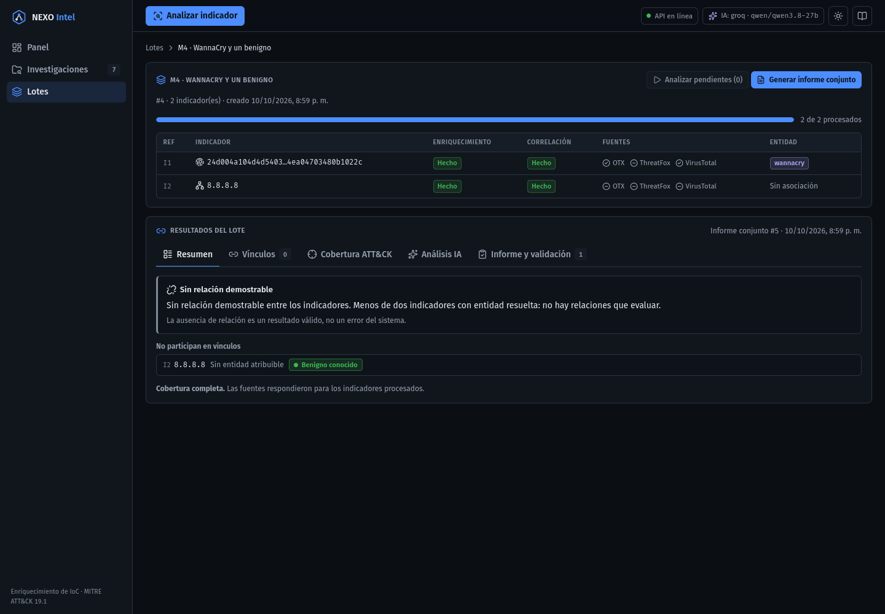 | 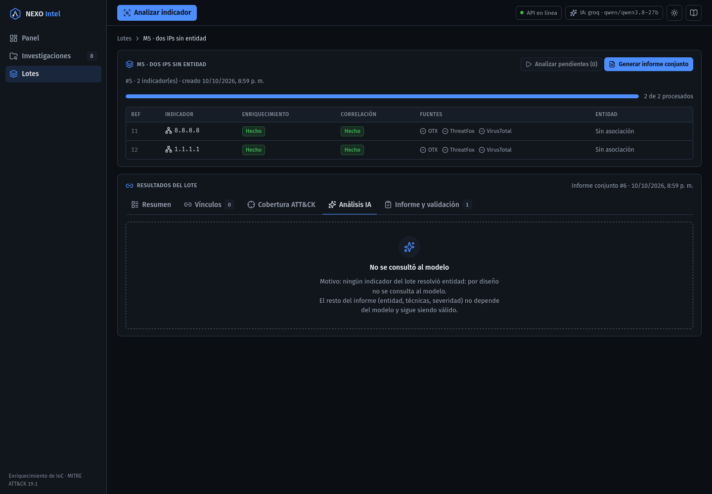 |
| **M11: LLM caído** | **M13: miembro eliminado** |
| 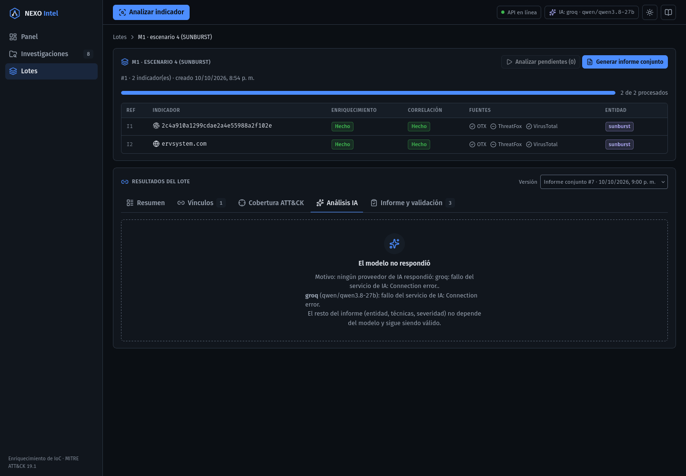 | 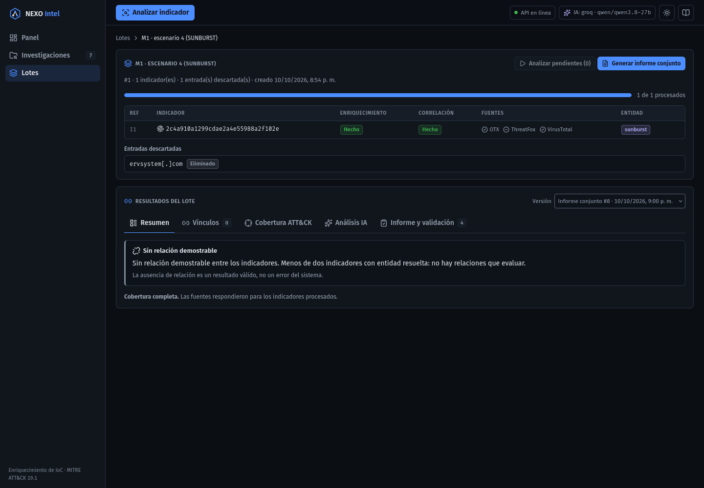 |

Móvil (390 px): 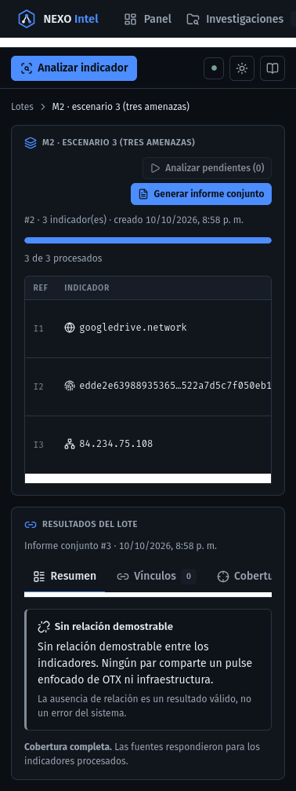

Las capturas se cuantizaron a 256 colores con Pillow: pasaron de 3,5 a 1,1 MB sin pérdida
visible.

## Verificación

- `npm run lint`, `typecheck`, `coverage` y `build` en verde.
- **175 pruebas**, frente a 171. Cobertura total: 97,6 % de sentencias, 93,4 % de ramas, 97,4 %
  de funciones y 98,7 % de líneas.
- **`Batch.test.tsx` (14):** la prueba de vínculos de la 7d se reemplazó por cuatro.
  1. **Flujo completo:**
     - vista previa sin informe (abstención neutral, vínculos y cobertura vacíos);
     - generar, que abre "Informe y validación";
     - Markdown con los valores como `CODE` y sin enlaces;
     - pestañas con la correlación congelada (señales con origen, enlace al pulse con `nofollow`,
       técnica con `varias`);
     - cita `E-V1` que resalta su bloque;
     - validar sin elegir, luego aceptar y luego rechazar, con el historial en orden.
  2. **Versiones:** la nueva queda pendiente, un error al validar no entra al historial y la
     versión anterior conserva su decisión.
  3. **Aislados:** se listan en una relación demostrable.
  4. **Generación:** confirmación con pendientes (cancelar no envía nada), espera con contador y
     aviso del 400.
- **`format.test.ts` (+1):** "Campaña ATT&CK".

### Criterios de aceptación

| # | Criterio | Estado |
|---|---|---|
| 1 | Lint, typecheck, cobertura de 90 % o más y build; las pruebas de `CaseDetail`, `AiAnalysisPanel` y `ValidationPanel` sin cambiar lo que afirman | ✅ (build con advertencia de tamaño; ver observaciones) |
| 2 | "Sin relación demostrable entre los indicadores" literal en tono neutral; la relación demostrable lista sus agrupaciones en tono info | ✅ |
| 3 | Cada vínculo con todas sus señales (origen y detalle); las técnicas compartidas solo en "Cobertura ATT&CK", con su leyenda | ✅ |
| 4 | Markdown sin HTML crudo; los valores no son enlaces | ✅ (prueba y en vivo: 0 enlaces) |
| 5 | Aceptar y luego rechazar dan 2 filas con "Rechazado" vigente; regenerar crea una versión pendiente | ✅ (prueba y M12 en vivo) |
| 6 | M1–M5 y M11–M13 ejecutados, con capturas | ✅ |

## Diferencias con el plan

- **Un solo archivo para las pestañas.** El plan proponía cuatro componentes
  (`BatchConclusion`, `LinksPanel`, `AttackCoverage`, `BatchReportTab`); quedaron como funciones
  internas de `BatchResults.tsx`. Es el mismo contenido en menos archivos.
- **El selector de versión gobierna todas las pestañas,** no solo la del informe: lo que se ve
  es exactamente lo que se valida.
- **Dos ajustes salieron de las pruebas manuales:**
  - El resumen no listaba los indicadores **aislados**, cosa que el Markdown sí hacía. Se
    detectó en M3, se corrigió y tiene prueba.
  - En móvil, los botones de la cabecera del lote se salían del panel. Ahora se envuelven.
- **Encabezados de las tablas del Markdown sin corte de línea.** En la tabla de vínculos,
  "Vínculo" se partía en sílabas. El ajuste también aplica al informe individual, solo en lo
  visual.

## Observaciones

- **El LLM atribuye la relación a la entidad y no a los pulses.** En M1 v2, el resumen dice
  "relación demostrable entre I1 e I2 **por compartir la entidad** sunburst". Para NEXO, la
  relación se sustenta en los pulses compartidos; la misma entidad es contexto. Los hallazgos sí
  citan `E-V1` con los 4 pulses, y la conclusión determinística, que va arriba, es la correcta.
  Mejora propuesta para el backend, de unas pocas líneas: que `E-LOTE` diga qué señales sostienen
  cada agrupación.
- **Doble punto en los motivos.** Cuando el motivo de la IA ya termina en punto, la interfaz y la
  plantilla del backend muestran "Connection error..". Pasa también en el informe individual.
- **Bundle de 502 kB** (154 kB comprimido), apenas sobre el umbral de advertencia de Vite. La
  salida, si molesta, es cargar las páginas de lotes con `React.lazy`.
- **Prueba intermitente.** "muestra todas las investigaciones de la plataforma y depura lo que ya
  no existe" (`App.test.tsx`, anterior a esta fase) falló una vez en 22 ms y pasó en todas las
  repeticiones.
- **Pestañas en móvil.** Se desplazan en horizontal, igual que en el detalle de un indicador.

## Estado de la Fase 7

El MVP (7a–7e) está completo. Los escenarios 3 y 4 de la propuesta pasan de **"Parcial" a
"Cumple"**, en pruebas automáticas (backend 7c) y por la interfaz contra las fuentes reales
(esta fase). Queda pendiente, como opcional, la **7f: validación por vínculo**.
