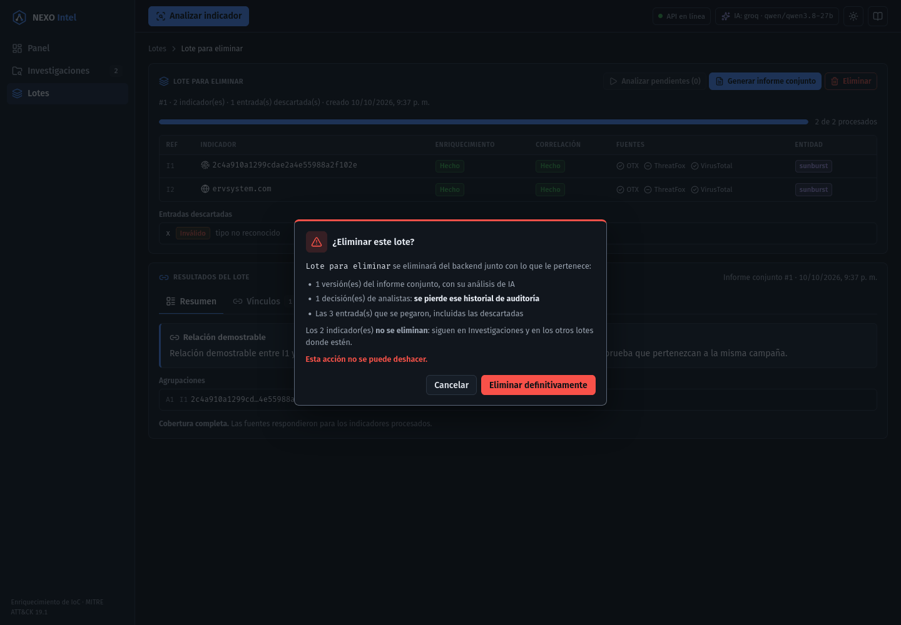

# Fase 7g — Eliminar lotes (interfaz)

Fecha: 2026-10-10. Consume `DELETE /batches/{id}`. El diseño completo, las pruebas del backend y
la verificación en vivo están en el informe del backend, `docs/evolucion/fase-07g-eliminar-lotes.md`.

## Qué se hizo

- **"Eliminar" en la cabecera de la página del lote.** Es un botón de peligro, deshabilitado
  mientras se analiza o se genera un informe.
- **Confirmación** con el mismo `ConfirmDialog` y los mismos estilos que la eliminación de un
  indicador. Lista lo que se pierde:
  - las versiones del informe conjunto;
  - las decisiones de analistas, con "se pierde ese historial de auditoría";
  - las entradas que se pegaron.

  Y aclara que **los indicadores no se eliminan**: siguen en Investigaciones y en los otros
  lotes donde estén.
- **Al confirmar,** vuelve a `#/lotes`. Si el backend falla, el diálogo sigue abierto con el
  error y "Eliminar definitivamente" reintenta. Un 404 (otra sesión ya lo borró) cuenta como
  éxito.
- **Acción `deleteBatch`** en `state/pipelineActions.ts`, que devuelve `DeleteResult` igual que
  `deleteIndicator`, y `nexoApi.deleteBatch`.

## Verificación

- **Lint, typecheck y build** en verde.
- **177 pruebas**, frente a 175, con cobertura de 97,6 %:
  - `pipelineActions.test.ts`: la acción con ok, 404 y caída.
  - `Batch.test.tsx`: consecuencias del diálogo, cancelar sin enviar nada, error y reintento,
    navegación a `#/lotes`, y ningún `DELETE /indicators`.
- **En vivo** contra el backend real (base local desechable): el lote se borró desde la
  interfaz y sus dos indicadores siguieron con su entidad.
